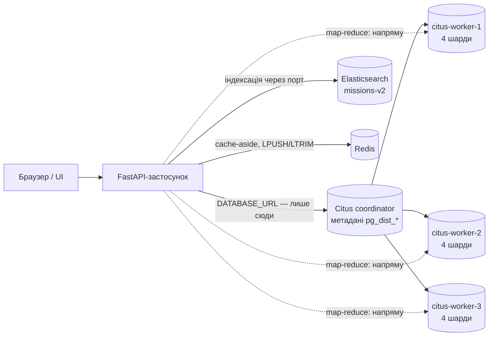

# Схема топології БД

> Розділ звіту (п. 13–15). Стек: **PostgreSQL + Citus** (основне сховище, шардінг), **Elasticsearch** (пошук),
> **Redis** (кеш). MongoDB у проєкті не використовується — нижче показано, як кожна вимога методички,
> сформульована в термінах MongoDB, реалізована на Citus.

## 1. Топологія



| Вузол | Образ | Роль | Порт назовні |
|---|---|---|---|
| `citus-coordinator` | citusdata/citus:12.1 | Маршрутизатор запитів + метадані кластера | 5432 |
| `citus-worker-1..3` | citusdata/citus:12.1 | Шарди таблиці `missions` (по 4 на вузол) | — (лише мережа compose) |
| `elasticsearch` | elasticsearch:8.11.1 | Повнотекстовий пошук, схожі місії | 9200 |
| `redis` | redis:7-alpine | Кеш пошуку й рекомендацій, останні запити | 6379 |
| `app` | наш Dockerfile | API + UI | 8000 |

## 2. Відповідність MongoDB → Citus

| Методичка (MongoDB) | Наша реалізація (Citus) |
|---|---|
| `mongos`, застосунок підключається тільки до нього | Координатор Citus; `DATABASE_URL` вказує лише на нього |
| config server | Метадані на координаторі: `pg_dist_node`, `pg_dist_shard`, `pg_dist_placement` |
| 3 шарди | 3 воркери |
| chunks | шарди (`missions_102008` … `missions_102019`), 12 штук |
| балансувальник | `citus_rebalance_start()` |
| `db.missions.getShardDistribution()` | `GET /api/sharding/distribution` (view `citus_shards` + `run_command_on_shards`) |
| `explain()`: `SINGLE_SHARD` vs `SHARD_MERGE` | `GET /api/sharding/explain`: `Task Count: 1` vs `Task Count: 12` |
| orphan documents під час міграції chunks | осиротілі розміщення шардів під час `citus_move_shard_placement` |

## 3. Ключ шардування: `id` (хеш)

Таблицю розподілено так: `create_distributed_table('missions', 'id', shard_count => 12)`.
`id` — UUIDv4, Citus хешує його й кладе рядок у шард за діапазоном хешу.

**Чому `id`:**
- **Рівномірно.** Хеш випадкового UUID розносить записи порівну: ~33 / 33 / 34 % по вузлах, 1400–1500 рядків на кожен із 12 шардів (замір на 17 461 рядку).
- **Немає «гарячого» шарда.** UUIDv4 не зростає монотонно, тож нові записи не збираються в одному шарді
  (аргумент методички проти монотонного `_id` стосується автоінкременту/ObjectId, не UUIDv4).
- **Картка місії — один шард.** `WHERE id = …` маршрутизується рівно в один шард (`Task Count: 1`).

**Чому не інші варіанти** (заміри — розподіл по 3 вузлах на 30 000 згенерованих місій):

| Ключ | Розподіл по вузлах | Запит за тілом іде в | Висновок |
|---|---|---|---|
| `celestial_body_id` | **0 / 100 / 0 %** | 1 шард | Тіл лише 3–5 → кілька велетенських шардів (аналог jumbo chunks), решта порожні |
| `тіло + 4 хеш-кошики` | 17 / 50 / 33 % | 3–4 з 12 | Мало різних значень ключа → колізії хешу, перекіс |
| `тіло + 16 кошиків` | 29 / 35 / 36 % | 9–11 з 12 | Рівніше, але маршрутизація за тілом майже зникає |
| **`id` (обрано)** | **33 / 33 / 34 %** | усі 12 (паралельно) | Рівномірно; точкові запити — один шард |

Чому не складений ключ `{celestial_body_id: 1, _id: "hashed"}`, як пропонує методичка: у MongoDB він працює,
бо chunks — це **діапазони** за префіксом `celestial_body_id`. Citus розподіляє за хешем **однієї** колонки, тож
префіксних діапазонів немає: або мало значень ключа (перекіс), або багато (запит за тілом іде на всі шарди).
Запит за тілом у нас іде на всі 12 шардів **паралельно**, а координатор зливає результат — це і є `SHARD_MERGE`.

Перевірити перекіс за тілом на живому кластері:
```sql
CREATE TABLE missions_by_body (LIKE missions);
SELECT create_distributed_table('missions_by_body', 'celestial_body_id', shard_count => 12);
INSERT INTO missions_by_body SELECT * FROM missions;
SELECT nodename, count(*) AS shards, sum(shard_size) AS bytes
FROM citus_shards WHERE table_name = 'missions_by_body'::regclass GROUP BY nodename;
```

## 4. Демонстрація (заповнити з запущеного кластера)

`docker compose up --build`, потім:

```bash
# воркери кластера
docker compose exec citus-coordinator psql -U space -d space -c "SELECT * FROM citus_get_active_worker_nodes();"
# розподіл (аналог getShardDistribution)
docker compose exec citus-coordinator psql -U space -d space -c \
  "SELECT nodename, count(*) AS shards, pg_size_pretty(sum(shard_size)) FROM citus_shards GROUP BY nodename;"
# план: один шард vs усі (аналог explain)
docker compose exec citus-coordinator psql -U space -d space -c \
  "EXPLAIN SELECT * FROM missions WHERE id = (SELECT id FROM missions LIMIT 1);"
docker compose exec citus-coordinator psql -U space -d space -c \
  "EXPLAIN SELECT count(*) FROM missions WHERE celestial_body_id = 'mars';"
```

Те саме видно в UI на вкладці «Шардінг / Map-Reduce».

**Вивід із запущеного кластера (2026-11-18, ~10 600 місій):**

Воркери (`citus_get_active_worker_nodes()`): `citus-worker-1`, `citus-worker-2`, `citus-worker-3`, порт 5432.

Розподіл (аналог `getShardDistribution()`):
```
    nodename    | shards | rows |  size
----------------+--------+------+---------
 citus-worker-1 |      4 | 3461 | 1808 kB
 citus-worker-2 |      4 | 3552 | 1864 kB
 citus-worker-3 |      4 | 3608 | 1832 kB
```
≈ 32.6 / 33.4 / 34.0 % — рівномірно.

Запит за ключем розподілу — **один шард** (аналог `SINGLE_SHARD`):
```
EXPLAIN SELECT * FROM missions WHERE id = 'ffe68d80-…';
 Custom Scan (Citus Adaptive)
   Task Count: 1
   Tasks Shown: All
   ->  Task
         Node: host=citus-worker-1 port=5432 dbname=space
         ->  Index Scan using missions_pkey_102008 on missions_102008 missions
               Index Cond: ((id)::text = 'ffe68d80-…'::text)
```

Запит за тілом — **усі 12 шардів**, координатор зливає результат (аналог `SHARD_MERGE`):
```
EXPLAIN SELECT count(*) FROM missions WHERE celestial_body_id = 'mars';
 Aggregate
   ->  Custom Scan (Citus Adaptive)
         Task Count: 12
         Tasks Shown: One of 12
         ->  Task
               Node: host=citus-worker-1 port=5432 dbname=space
               ->  Aggregate
                     ->  Bitmap Heap Scan on missions_102008 missions
                           ->  Bitmap Index Scan on ix_missions_celestial_body_id_102008
```

## 5. Map-Reduce (п. 14)

Через координатор агрегація відбувається автоматично: він сам розсилає часткові запити воркерам і зливає
результат. Щоб показати процес явно, map-reduce написано вручну (`application/mapreduce_service.py`):

1. **Розміщення і момент зрізу.** З координатора читаємо, які таблиці-шарди лежать на якому воркері
   (`pg_dist_shard` ⨝ `pg_dist_placement` ⨝ `pg_dist_node`, лише `shardstate = 1`), і беремо момент зрізу
   `now() - 2 s` за годинником БД. І map, і перевірка рахують лише рядки з `created_at <= зріз`:
   генератор пише безперервно, і без зрізу координатор бачив би кілька нових рядків, яких не бачила map-фаза
   (це виявилося під час першого запуску на реальному кластері). Запас 2 с покриває транзакції, які почалися до
   зрізу, але ще не закомічені.
2. **Map.** `asyncio.gather` — паралельне пряме підключення (asyncpg) до кожного воркера. Воркер рахує частковий
   результат по своїх шардах; для кожного вузла заміряється `map_ms`.
3. **Reduce.** Часткові результати зливаються в Python; заміряється `reduce_ms`.
4. **Перевірка.** Та сама агрегація через координатор; `match: true`, якщо результати однакові.

Задачі (`GET /api/mapreduce/{job}`):
- `decades` — кількість місій і частка успішних за десятиліттями; успіх = COMPLETED / (COMPLETED + FAILED).
  Map: `{десятиліття: [усього, успішних, невдалих]}`; reduce: поелементна сума.
- `terms` — топ-20 термінів у звітах (`report`) за небесними тілами (word count).
  Map: `regexp_split_to_table(lower(report), '[^a-z]+')` + `GROUP BY` тіло, термін; reduce: `Counter.update`,
  стоп-слова відкидаються, сортування за (−частота, термін) — детерміноване.

Сторінка показує підсумок, внесок кожного вузла (рядки, шарди), час map кожного вузла й час reduce.

**Відповіді на ймовірні питання:**
- *Чому не вбудований mapReduce?* У MongoDB `mapReduce` застарів з версії 5.0, рекомендована заміна — aggregation
  pipeline. У Citus аналог — розподілене виконання агрегатів координатором (pushdown на воркери); ми його
  використовуємо для перевірки, а власний map-reduce пишемо, щоб показати процес.
- *Що з «осиротілими» даними?* Під час переміщення шарда (`citus_move_shard_placement`, ребаланс) стара копія
  якийсь час лишається на старому вузлі до відкладеного очищення. Якщо читати воркери напряму «всліпу», ці рядки
  можна порахувати двічі. Тому розміщення читаються з метаданих на початку задачі — лише активні.
- *Альтернатива?* Apache Spark із JDBC-конектором до PostgreSQL — потужніше, але значно важче в налаштуванні.

## 6. Пошук і кеш (п. 15)

**Elasticsearch, індекс `missions-v2`:**
- `report`, `description`, `name` — `text` з `analyzer: english` (стемінг: *landing* знаходить *landed*, *lands*);
  `type`, `status`, `agency_id`, `celestial_body_id` — `keyword` з нормалізатором до нижнього регістру (фільтри).
- Пошук: `multi_match` по `name^3, report, description` (`fuzziness: AUTO`) + `bool.filter` за фільтрами;
  `highlight` з `<mark>`, `encoder: html` (текст екранується, тож UI безпечно вставляє фрагменти).
- Індексація — через порт: `MissionCommandService` після запису в SQL викликає `MissionSearchPort.index_many()`
  (синхронна обробка події «MissionCreated» без брокера). Якщо індекс порожній, а SQL — ні (напр. новий маппінг),
  на старті виконується переіндексація з SQL.

**Redis:**
- Нормалізація запиту (`application/search_normalization.py`): нижній регістр, без пунктуації, слова відсортовані,
  плюс відсортовані фільтри й пагінація → `search:<sha1>`. `"Rover, LANDING!"` і `"landing rover"` — один ключ.
- Cache-aside: `GET search:<hash>` → промах → Elasticsearch → `SET … EX 300` (TTL 5 хв, `SEARCH_CACHE_TTL`).
  Компроміс: новий документ може не з'явитися в закешованому результаті до 5 хв.
- Останні запити: `LPUSH recent_queries <json>` + `LTRIM recent_queries 0 19` — 20 останніх, зі статусом
  «Знайдено» / «Пусто», HIT/MISS і фільтрами.
- Якщо Redis недоступний, пошук працює без кешу (помилки лише логуються).

**UI (вкладка «Пошук»):** сніпети з підсвічуванням, бейдж **HIT/MISS**, час відповіді в мс, список останніх
запитів зі статусом «Знайдено»/«Пусто» (клік повторює запит).
