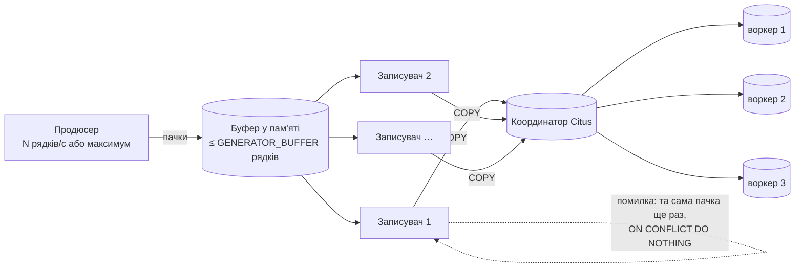

# Навантажувальне тестування, видалення даних і відмовостійкість

> Розділ звіту. Усе нижче видно у веб-застосунку: вкладки **«Навантаження»** і **«Відмовостійкість»**.
> Числа в таблицях «Результати» заповнюються з власних прогонів (кнопка «Почати замір» зберігає їх у
> `logs/benchmarks.jsonl`, часовий ряд — кнопка **CSV**). Вигадані числа в звіт не вносимо.

## 1. Що є в системі

| Вимога | Де в застосунку | Як реалізовано |
|---|---|---|
| Запис ≥ 30 хв на максимальній швидкості | «Навантаження» → режим **«Максимум»** або замір на 30 хв | `adapters/outbound/fake_generator.py`: без обмеження кількості рядків; `writers` паралельних з'єднань пишуть пачками через `COPY` |
| Виміряти швидкість у часі | графіки «Записано рядків за секунду», «Час запису пачки», «Розмір таблиці»; CSV | `application/load_metrics.py`: точка кожні 2 с з лічильників генератора (без `count(*)`), розмір — `citus_total_relation_size` раз на 15 с |
| Порівняти прогони | таблиця «Заміри» + графік порівняння | `application/benchmark_service.py`: середня, перше/останнє вікно, зміна %, p50/p95 часу пачки, розмір; файл спільний для всіх топологій |
| 1 вузол vs 3 воркери | `docker-compose.single.yml` | Той самий Citus і ті самі 12 шардів, але всі на координаторі (`CITUS_SINGLE_NODE=1`) |
| Часткове / повне видалення | «Навантаження» → «Видалення даних»; консоль `tools/data_admin.py` | `application/data_admin_service.py`: `DELETE … WHERE` / `TRUNCATE` + Elasticsearch + скидання кешу Redis; `VACUUM` |
| Відключення шарда без втрати даних | «Відмовостійкість»; `scripts/outage_demo.sh` | Пачка, яку БД не прийняла, не відкидається, а повторюється (ідемпотентно); стан вузлів; знімок і перевірка `count(*)` |
| Бонус: модифікації під навантаженням | «Генератор» → UPDATE/DELETE за id, масовий UPDATE | Цикл модифікацій у генераторі; на графіку окремі лінії UPDATE/DELETE |
| Бонус: шарди на різних комп'ютерах | `docker-compose.remote-worker.yml`, кнопка «Ребалансувати шарди» | [multi_host.md](multi_host.md) |

### Як пише генератор



* **Пачка атомарна.** `COPY` у розподілену таблицю виконується в одній розподіленій транзакції: або вся пачка
  потрапляє в шарди, або жоден рядок.
* **Повтор без дублікатів.** Якщо запис не вдався, записувач повторює *ту саму* пачку з паузою 0,5 → 5 с.
  Повтор іде через `INSERT … ON CONFLICT (id) DO NOTHING`. Тож якщо попередня спроба таки закомітилась, а
  відповідь загубилась (обрив з'єднання), дублікатів не буде.
* **Backpressure.** Поки БД недоступна, продюсер наповнює буфер до `GENERATOR_BUFFER` рядків (100 000 за
  замовчуванням), а далі пригальмовує. Тому завжди виконується **згенеровано = записано + у буфері**.
* **Кількість рядків у шапці** — це лічильник застосунку: точний `count(*)` плюс усі вставки й видалення
  через застосунок. `count(*)` щосекунди на десятках ГБ сам навантажував би кластер і псував замір.
* **Точний підрахунок без зупинки запису** (на старті, кнопка «Перерахувати», знімок і перевірка на вкладці
  «Відмовостійкість»; `application/consistent_count.py`). Запис зупиняється лише на мить, поки допишуться
  поточні пачки (~0,3 с). У цю мить фіксуються час БД (`now()` координатора) і лічильники. Далі запис іде,
  а рахується `count(*) WHERE created_at <= цей момент`: рядки, вставлені під час підрахунку, у число не
  потрапляють. DELETE генератора на час підрахунку відкладаються. На нашому кластері (~1 млн рядків,
  максимальна швидкість, UPDATE і DELETE увімкнено) підрахунок тривав ~6 с, запис ішов далі
  (6 500–11 000 р/с замість ~10 000), а перевірка зійшлась точно.
  Поки йде перший підрахунок після старту, шапка показує «рахується…».

## 2. Скільки даних

Вимога: щоб запис міг іти хоча б 30 хв на максимальній швидкості; загальний обсяг може сягати ~100 ГБ.

* Генератор не має ліміту кількості рядків. Розмір рядка разом з індексами видно наживо: «Розмір таблиці» ÷
  «рядків у БД». Цю оцінку варто вписати в звіт за результатами першого прогону.
* **Перед довгим прогоном перевірте диск Docker:** Docker Desktop → Settings → Resources → *Disk usage limit*
  (типово 64 ГБ на весь Docker), а також `docker system df -v`. Дані лежать у томах `citus_worker1..3`,
  `citus_coordinator`, `esdata`. Індекс Elasticsearch теж займає місце. Для чистого заміру запису в БД
  вимкніть «Індексувати в Elasticsearch».
* Звільнити місце: «Видалити все» (`TRUNCATE`) або `docker compose down -v` (видаляє томи разом із даними).

## 3. Методика заміру

1. `docker compose up --build`, відкрити http://localhost:8000 → «Навантаження».
2. За потреби почати з порожньої таблиці («Видалити все»), щоб прогони були порівнянні.
3. Вирішити, що вимірюємо: **чистий запис у Citus** (Elasticsearch вимкнено) чи **весь шлях запису**
   (з індексацією). Для питань методички — перше. Друге — окремим прогоном, щоб показати, скільки коштує пошук.
4. «Заміри»: мітка (напр. «3 воркери, без ES»), тривалість 30 хв, режим «максимум» → «Почати замір».
   **Налаштування генератора задайте до старту:** на час заміру вони заблоковані (форма неактивна, API
   відповідає 409). Тож у збереженому результаті завжди саме ті налаштування, з якими вимірювали.
5. Під час прогону стежимо за графіками. Після завершення рядок з'являється в таблиці. Позначте прогони
   галочками, щоб порівняти їх на одному графіку. CSV — для звіту/Excel.

Параметри, що впливають на результат і мають бути однаковими в прогонах, які порівнюємо: розмір пачки,
кількість записувачів, Elasticsearch увімк./вимк., модифікації вимк., стартовий обсяг таблиці.

## 4. Питання методички

### 4.1. Чи зменшується швидкість запису з часом? Через скільки? Як уникнути?

**Як виміряти.** Замір 30 хв на максимумі з порожньої таблиці. Дивимось на графік «Записано рядків за
секунду» і колонки «Перше вікно / Останнє вікно / Зміна» в таблиці замірів. Перше вікно (60 с) починається
після розгону: перші 10 с, поки генератор набирає швидкість, пропускаються. Інакше перше вікно виглядало б
повільнішим, ніж є, і «зміна» приховувала б реальне падіння. «Час запису пачки» показує те саме
з іншого боку: якщо пачка пишеться довше, швидкість падає. Момент, коли почалося падіння, зручно
зіставити з «Розміром таблиці»: падіння зазвичай починається, коли індекси перестають вміщатися в пам'ять.

**Результати** (заповнити):

| Прогін | Перша хвилина, р/с | Остання хвилина, р/с | Зміна | Коли почалося падіння (хв / розмір БД) |
|---|---|---|---|---|
| 3 воркери, без ES, 30 хв | | | | |
| 3 воркери, з ES, 30 хв | | | | |

**Чому швидкість може падати** (перевіряємо на графіках, які з причин видно):

1. **Індекси більші за пам'ять.** Окрім первинного ключа, на таблиці 6 B-tree індексів (`type`, `status`,
   `agency_id`, `celestial_body_id`, `launch_year`, …). Кожна вставка оновлює всі 7. Поки індекси вміщаються
   в `shared_buffers` (у образі citus — 128 МБ) і кеш ОС, вставка пише в пам'ять. Коли перестають — кожна
   вставка читає сторінки індексу з диска, і швидкість помітно падає. Первинний ключ — **випадковий UUIDv4**,
   тож вставки потрапляють у випадкові сторінки індексу (на відміну від автоінкременту, де пишеться завжди
   «правий край» дерева).
2. **Контрольні точки (checkpoint) і WAL.** На великому потоці записів `max_wal_size` (1 ГБ) швидко
   заповнюється. Тоді PostgreSQL примусово скидає брудні сторінки на диск — на графіку це періодичні «зубці».
3. **Autovacuum / analyze** великої таблиці конкурує із записом за диск.
4. **Elasticsearch** (якщо увімкнено): злиття сегментів і `refresh` гальмують індексацію, а з нею й записувачів,
   бо вони чекають на індексацію пачки.
5. **Обмеження Docker Desktop** (віртуальна машина, спільний диск і CPU для всіх контейнерів).

**Як уникнути / пом'якшити:**
- писати пачками й через `COPY` (уже так), збільшити розмір пачки й кількість записувачів;
- менше вторинних індексів: на час масового завантаження прибрати їх, а після завантаження створити заново;
- первинний ключ, що зростає в часі (UUIDv7 / ULID): вставки йдуть у «правий край» індексу. Хеш-розподіл
  Citus по шардах при цьому лишається рівномірним;
- більше вузлів: на кожному вузлі менший індекс, тож він довше вміщається в пам'ять;
- налаштування PostgreSQL: більші `shared_buffers`, `max_wal_size`, `checkpoint_timeout`; `synchronous_commit=off`
  (ціна — можлива втрата останніх транзакцій при збої);
- секціонування за часом (partitioning): індекси старих секцій не змінюються, а стара секція видаляється миттєво;
- асинхронна індексація в Elasticsearch, більший `refresh_interval` під час завантаження.

### 4.2. Якщо зупинити запис і запустити знову — швидко чи так само повільно? Від чого залежить швидкість?

**Як виміряти.** Після того як швидкість просіла (п. 4.1): «Режим → Пауза» на 2–5 хв, потім знову
«Максимум» (або новий замір на 5 хв). На графіку видно паузу (нуль), а лінія «задана швидкість» показує,
що змінювали. Порівнюємо швидкість до паузи з першою хвилиною після.

| До паузи, р/с | Пауза, хв | Перша хвилина після, р/с | Через 5 хв після, р/с |
|---|---|---|---|
| | | | |

**Як читати результат:**
- Якщо після паузи запис *на якийсь час швидший*, а потім знову просідає — частина гальмування була
  **тимчасовою**. Під час паузи завершились контрольна точка й autovacuum, а Elasticsearch злив сегменти.
- Якщо *одразу так само повільно* — гальмування **структурне**: індекси не вміщаються в пам'ять, і пауза
  цього не змінює. Допомагають лише заходи з п. 4.1.

**Приклад, знайдений під час налаштування (виміряно на нашому кластері, 3 воркери в Docker на одному ноутбуці).**
Спочатку пачка з 1000 рядків писалася ~2,3 с, а воркери були завантажені на 110–180 % CPU, хоча даних було мало.
Причина: Citus за замовчуванням тримає між транзакціями лише одне з'єднання координатора з кожним воркером
(`citus.max_cached_conns_per_worker = 1`). `COPY` у 12 шардів відкриває кілька з'єднань на воркер, тож кожна
пачка заново встановлювала SSL-з'єднання й запускала процеси на воркерах. Після
`citus.max_cached_conns_per_worker = 16` для сесій застосунку пачка пишеться ~0,3 с, а швидкість на максимумі
(без Elasticsearch) зросла приблизно з 1 800 до 13 500 рядків/с. Тобто швидкість запису залежить не лише від
даних, а й від накладних витрат на з'єднання між вузлами.

**Від чого залежить швидкість запису:** розмір індексів відносно пам'яті та їх кількість; розмір пачки
й кількість паралельних з'єднань; швидкість диска і WAL (контрольні точки); кількість вузлів і мережа між
ними (кожна пачка — розподілена транзакція з 2PC); синхронна індексація в Elasticsearch; конкуруючі запити
(модифікації, `count(*)`, map-reduce, VACUUM).

### 4.3. Один вузол чи багато (3+)?

**Як виміряти:**
```bash
docker compose down                                    # 3 воркери: зупинити (без -v — дані лишаються)
docker compose -f docker-compose.single.yml up --build # 1 вузол: той самий Citus, 12 шардів на координаторі
#   … замір 30 хв, «максимум», без ES, мітка «1 вузол» …
docker compose -f docker-compose.single.yml down
docker compose up -d                                   # назад до 3 воркерів
#   … такий самий замір з міткою «3 воркери» …
```
Обидві конфігурації пишуть результати в той самий `logs/benchmarks.jsonl`, тож у таблиці замірів видно обидві
топології поруч. Порівнюйте прогони з однаковими параметрами й однаковим стартовим обсягом.

| Топологія | Середня, р/с | Перша хв | Остання хв | p95 пачки, мс | Розмір після 30 хв |
|---|---|---|---|---|---|
| 1 вузол | | | | | |
| 3 воркери | | | | | |

**Що варто пояснити на захисті:**
- На **одному ноутбуці** 3 воркери ділять ті самі ядра CPU і той самий диск, тож лінійного прискорення немає.
  Розподілений запис ще й додає мережеві переходи та розподілену транзакцію (2PC) на кожну пачку. Тому на
  початку 1 вузол може бути навіть швидшим.
- Перевага кількох вузлів має проявитися **з часом**: на кожному вузлі втричі менший індекс, тож він довше
  вміщається в пам'ять, і падіння з п. 4.1 настає пізніше. Це видно на графіку порівняння: порівнюйте не лише
  середню, а й колонку «Зміна».
- На **різних комп'ютерах** (бонус, [multi_host.md](multi_host.md)) вузли не ділять CPU й диск, і масштабування
  запису помітніше.
- Вузьке місце обох конфігурацій — **координатор**: кожна пачка проходить через нього. Для подальшого
  масштабування Citus дозволяє писати через будь-який воркер (metadata sync), але ми цього не робили.

## 5. Видалення даних

| Що | UI | Консоль |
|---|---|---|
| Скільки рядків під фільтром | «Скільки буде видалено?» | `docker compose exec app python -m tools.data_admin preview --body mars` |
| Часткове | фільтри → «Видалити N рядків» | `… tools.data_admin delete --body mars --year-to 1990` |
| Повне | ввести «ВИДАЛИТИ» → «Видалити все» | `… tools.data_admin delete-all --yes` |
| Повернути місце | VACUUM / VACUUM FULL | `… tools.data_admin vacuum [--full]` |
| Одна місія | картка місії → «Видалити місію» | `curl -X DELETE localhost:8000/api/missions/<id>` |
| Напряму в БД | — | `docker compose exec citus-coordinator psql -U space -c "TRUNCATE missions"` |

- **Часткове:** `DELETE … WHERE` координатор розсилає на всі 12 шардів (фільтр не за ключем розподілу).
  Elasticsearch — `delete_by_query` у фоні, бо мільйони документів видаляються довго. Redis — кеш пошуку й
  рекомендацій скидається, інакше ще 5 хв (TTL) показувалися б видалені місії.
- **Розмір після DELETE не зменшується**: PostgreSQL лише позначає рядки мертвими (MVCC). `VACUUM` дозволяє
  використати це місце для нових записів, `VACUUM FULL` переписує таблицю й повертає місце ОС, але блокує
  таблицю на весь час виконання. На захисті це видно з розміру «до → після».
  Тривалість росте з розміром таблиці: на нашому кластері `VACUUM FULL` на 530 МБ тривав 84 с
  (530 → 484 МБ). На десятках ГБ це будуть десятки хвилин, тож на захисті краще показувати звичайний `VACUUM`
  або `VACUUM FULL` на невеликій таблиці. Ліміту часу на VACUUM у застосунку немає.
- **Повне:** `TRUNCATE` — миттєво й одразу звільняє місце; індекс Elasticsearch перестворюється.
- Видалення можна запускати під навантаженням — це теж «модифікація під навантаженням» (п. 7).
- Якщо видаляли напряму через `psql`, натисніть «Перерахувати», бо лічильник застосунку таких змін не бачить.

## 6. Відключення шарда і повернення без втрати даних

**Демонстрація** (вкладка «Відмовостійкість», або все одним скриптом `./scripts/outage_demo.sh citus-worker-2 60 2000`):

1. Генератор пише (напр. 2000 р/с, без DELETE) → **«Зафіксувати стан»**: точний `count(*)` + лічильники +
   розподіл рядків по вузлах.
2. `docker compose stop citus-worker-2`. Що видно:
   - у таблиці вузлів `citus-worker-2` — **недоступний** (пряме підключення не проходить);
   - журнал: «Запис у БД не вдається — пачки тримаються в буфері й повторюються»;
   - «У буфері» росте, «невдалих спроб» росте, «записано в БД» стоїть;
   - пошук (вкладка «Пошук») працює далі: Elasticsearch — окремий сервіс. Список місій і картки, що лежать на
     вимкненому вузлі, повертають 503 з поясненням — це очікувано.
3. `docker compose start citus-worker-2`. Журнал: «Вузол знову доступний», «Запис відновлено через N с».
   Буфер дописується (на графіку швидкості — сплеск вище заданої).
4. **«Перевірити»**: очікувано = знімок + записано після знімка − видалено після знімка;
   фактично = `count(*)`. **Втрачено = 0**. Таблиця по вузлах показує, що рядки на `citus-worker-2` не
   зникли, а лише додались нові.

**Чому дані не губляться:**
- Дані вимкненого воркера лежать на його томі (`citus_worker2`). `stop/start` контейнера їх не зачіпає, і після
  повернення вузол віддає ті самі шарди: метадані на координаторі не змінювались.
- Рядки, які генератор намагався записати під час відмови, не відкидаються: вони чекають у буфері, і пачка
  повторюється, доки БД її не прийме. `COPY` атомарний, а повтор ідемпотентний — без дублікатів і без пропусків.
- Незавершені розподілені транзакції (2PC), що обірвались посеред коміту, Citus завершує сам після
  повернення вузла (`citus.recover_2pc_interval`).

**Перевірено на нашому кластері** (`scripts/outage_demo.sh`, 3 воркери):

| Сценарій | Записано після знімка | Буфер на піку | Очікувано = фактично | Втрачено |
|---|---|---|---|---|
| `citus-worker-2` вимкнено на 30 с, 2000 р/с | 97 770 | ~74 000 | 1 037 767 | 0 |
| `citus-worker-3` вимкнено на 60 с, 3000 р/с (буфер переповнився → генератор пригальмував) | 151 103 | 100 000 (ліміт) | 1 221 365 | 0 |

Ця перевірка знайшла справжню помилку: перша версія повтору пачки (`INSERT … SELECT FROM unnest(…)` з
параметрами) у Citus 12.1 вставляла 1 рядок замість пачки, і після відновлення «зникало» 877 рядків. Тепер
повтор — багаторядковий `INSERT … VALUES … ON CONFLICT DO NOTHING`.

**Чесні обмеження (варто сказати на захисті):**
- Поки воркер вимкнений, недоступні **запис усієї таблиці** (кожна пачка зачіпає всі шарди) і **читання його
  шардів**. Дані не губляться, але в цей час система для них недоступна. Щоб читання й запис тривали без
  перерви, потрібні репліки кожного воркера (streaming replication) з перемиканням на репліку. Це наступний
  крок, ми його не реалізовували.
- Буфер живе в пам'яті застосунку. Якщо впаде *сам застосунок*, рядки з буфера втратяться: їх треба
  перезапитати в джерела. У реальній системі цю роль виконує черга (Kafka) з комітом зміщення після
  підтвердження запису.
- До цієї зміни генератор у разі помилки **відкидав** пачку (лише записував у лог). Саме тому повтор
  з буфером — головна зміна для цієї вимоги.

## 7. Бонус: модифікації під навантаженням

«Генератор» → «Бонус: модифікації під навантаженням»:
- **UPDATE за id / с** — `UPDATE missions SET status = … WHERE id = ANY(…)`: за ключем розподілу, тож Citus
  шле запит лише в потрібні шарди;
- **DELETE за id / с** — те саме для видалення (id беруться з нещодавно вставлених);
- **Масовий UPDATE кожні N с** — `UPDATE … WHERE celestial_body_id = … AND launch_year = …`. Фільтр не за
  ключем розподілу, тож координатор розсилає запит на всі 12 шардів. Запит зачіпає ~0,5 % таблиці й тримає
  блокування рядків, тож на графіку видно, як просідає INSERT.

Те саме з Elasticsearch: оновлення статусу — `bulk update` / `update_by_query`, видалення — `bulk delete`.
Як вимірювати: однаковий замір без модифікацій і з ними; порівняти середню й p95 часу пачки.

| Прогін | Середня INSERT, р/с | p95 пачки, мс | UPDATE/с | DELETE/с |
|---|---|---|---|---|
| без модифікацій | | | – | – |
| UPDATE 500/с + DELETE 100/с | | | | |
| + масовий UPDATE кожні 10 с | | | | |

## 8. Шпаргалка для захисту

```bash
docker compose up --build -d                       # 3 воркери
open http://localhost:8000                         # «Навантаження» / «Відмовостійкість»
docker compose exec app python -m tools.data_admin stats
docker compose exec app python -m tools.data_admin generator --max
./scripts/outage_demo.sh citus-worker-2 60 2000    # відключення шарда без втрати даних
docker compose exec app python -m tools.data_admin delete --body venus
docker compose exec app python -m tools.data_admin vacuum
docker compose exec app python -m tools.data_admin delete-all --yes
docker compose -f docker-compose.single.yml up -d  # 1 вузол (попередньо docker compose down)
```
